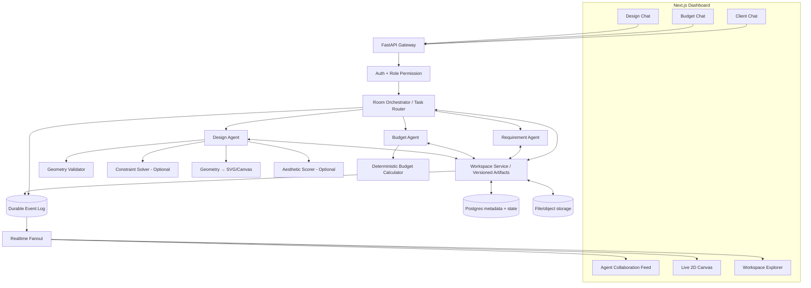
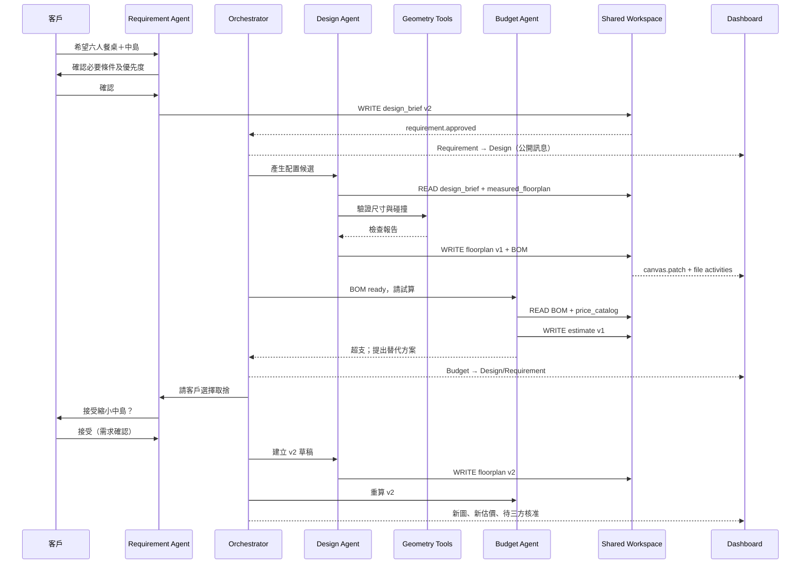
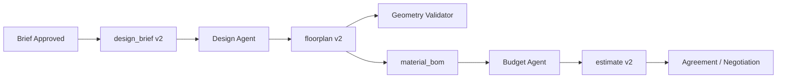

# AgentRoom Interior — 多角色 AI 室內設計協作平台

> **產品需求文件（PRD）＋系統架構（Architecture）＋工程實作規格（Technical Specification）＋研究計畫（Research Plan）**  
> 文件版本：v1.0｜日期：2026-11-11｜語言：繁體中文  
> 專案定位：YC Multiplayer AI 題型之室內設計垂直應用  
> 文件狀態：**提案／開發規格，非已完成或已驗證之產品**

---

## 目錄

1. [產品願景、範圍與重要決策](#1-產品願景範圍與重要決策)
2. [角色、權限與人機互動](#2-角色權限與人機互動)
3. [真實工作情境與核心用例](#3-真實工作情境與核心用例)
4. [Dashboard 與前端 UX 規格](#4-dashboard-與前端-ux-規格)
5. [整體系統架構](#5-整體系統架構)
6. [三個 Agent 的職責與工具](#6-三個-agent-的職責與工具)
7. [Agent 協作協定與執行狀態機](#7-agent-協作協定與執行狀態機)
8. [Shared Workspace：檔案與版本系統](#8-shared-workspace檔案與版本系統)
9. [設計圖生成、畫布指令與版本回放](#9-設計圖生成畫布指令與版本回放)
10. [精確空間感知與幾何驗證](#10-精確空間感知與幾何驗證)
11. [配置最佳化、3D 與美感研究](#11-配置最佳化3d-與美感研究)
12. [預算計算、BOM 與設計變更連動](#12-預算計算bom-與設計變更連動)
13. [資料庫、API 與即時事件](#13-資料庫api-與即時事件)
14. [專案程式碼結構與部署](#14-專案程式碼結構與部署)
15. [安全、可靠性與資料治理](#15-安全可靠性與資料治理)
16. [黑客松 MVP 實作與 90 秒 Demo](#16-黑客松-mvp-實作與-90-秒-demo)
17. [測試、驗收標準與研究 Benchmark](#17-測試驗收標準與研究-benchmark)
18. [後續 Roadmap 與待決策清單](#18-後續-roadmap-與待決策清單)
19. [研究與工程參考](#19-研究與工程參考)

---

## 1. 產品願景、範圍與重要決策

### 1.1 一句話定位

**Three human collaborators, three specialized AI agents, one shared design.**  
讓客戶、預算設計師與空間設計師各自和專業 Agent 對話，同時透過中央 AgentRoom 與共享檔案共同完成**需求探索 → 圖面生成 → 空間檢查 → 預算試算 → 協調修改 → 三方核准**。

### 1.2 產品解決的核心問題

- 客戶以自然語言描述「溫暖、簡約、收納多」，設計師難以立即轉換成可驗證需求。
- 需求在聊天、會議、參考圖片、PDF、估價表之間散落，修改容易漏掉。
- 方案在視覺上好看，不代表家具的**真實尺寸、椅子拉出空間、門片開啟與動線**可行。
- 設計圖修改後，材料數量、預算、批准紀錄不一定同步。
- 團隊看不到 Agent 的**工作交接、檔案讀寫、決策依據與成果演進**。

### 1.3 架構原則（不可妥協）

1. **固定 3 個對外可見專業 Agent**：Requirement、Budget、Design。Orchestrator 是後端服務，不是第四個聊天 Agent。
2. **每人一個私人 Agent Chat**，中央展示**公開的 Agent-to-Agent 業務訊息**，兩者權限分離。
3. **共享狀態與檔案為權威來源**；聊天文字不直接當正式設計需求。
4. **2D/3D 共享一份權威幾何資料（Canonical Geometry）**，單位採 mm，座標與物件 ID 穩定。
5. **數學與幾何計算由可測試的程式／求解器執行**；LLM 負責理解、規劃、提案與解釋。
6. **Agent 可提出草稿，不可覆寫已核准設計／預算**；人類審核是正式變更的必要條件。
7. **公開的是 Agent 發送的訊息、工具呼叫摘要、檔案活動和輸出**，不展示模型私有內部推理。
8. **每次寫入與工具動作都附 run_id、版本與事件序號**，可回放、追蹤、去重。
9. **設計美感與幾何可行性分離**：先確認硬性限制，再比較風格與偏好。

### 1.4 範圍分層

| 項目 | P0：黑客松 MVP | P1：可用原型 | P2：研究／商業化 |
|---|---|---|---|
| 三個私人對話 | 真正 LLM、多種 System Prompt | 多人登入、Session 恢復 | 長期偏好與權限深化 |
| 中央 Agent Room | 真正跨 Agent 訊息及事件 | 分支、搜尋、回放、提案審查 | 跨專案工作流程 |
| 共用檔案 | JSON/Markdown/SVG、讀寫記錄 | 版本、Diff、依賴關係 | CAD/BIM、外部檔案整合 |
| 設計圖 | 2D 矩形與指定物件、動態 patch | 門窗、家具編輯與精確驗證 | 3D/材質、複雜空間 |
| 空間正確性 | mm、邊界、碰撞、簡化淨空 | 走道、門片、使用範圍、路徑 | 人體工學、無障礙與專業檢核 |
| 美感 | 風格板與方案比較 | VLM 評估、配色／材質 | 偏好學習、排名模型 |
| 預算 | 固定範例型錄、公式重算 | 真實供應商資料與變更單 | 採購、交期、施工管理 |

**明確不在 P0 範圍：** 自動產生合法可施工圖、從單張照片推算絕對尺寸、全自動報價承諾、無人審核直接施工、任意 Agent 執行 OS 指令、完整 CAD/BIM 互通、訓練大型 3D 模型。

---

## 2. 角色、權限與人機互動

### 2.1 三個人類與三個 Agent

| 人類使用者 | 對應 Agent | 私人 Chat 主要目的 | 對共享資料的正式決策權 |
|---|---|---|---|
| 客戶 Client | **Requirement Agent** | 生活需求、風格喜好、需求優先度、可接受取捨 | 確認客戶需求與設計變更意願 |
| 設計師 A | **Budget Agent** | 報價、材料規格、數量、預算與替代方案 | 核准正式成本估價與計價假設 |
| 設計師 B | **Design Agent** | 配置、尺寸、家具位置、材料與圖面修改 | 核准設計圖與專業檢查結果 |

**注意：** 一個人可以在 Demo 的管理視圖同時看到三個角色，但正式系統不能因「UI 看得到」就賦予操作權限。

### 2.2 使用者／Agent 各自能看見什麼

- `private:client`：客戶與 Requirement Agent 訊息；其他角色不可自動閱讀全文。
- `private:budget`：設計師 A 與 Budget Agent 訊息；可包括內部成本及利潤，不默認公開。
- `private:design`：設計師 B 與 Design Agent 訊息；包含工作草稿與專業審核。
- `shared:agents`：三 Agent 主動**發布**的協作訊息、任務交接、公開提案及工具結果。
- `shared:canvas`：已授權的圖面草稿與發布版本。
- `shared:workspace`：依檔案 ACL 決定是否可檢視內容，活動紀錄也應避免洩漏受限檔名或內容。

### 2.3 審核策略

- Requirement Agent 可寫 `requirements/drafts/`；客戶核准後產生 `requirements/approved/...`。
- Design Agent 可寫 `design/drafts/`；設計師 B 核准後才更新正式圖面。
- Budget Agent 可寫 `budget/drafts/`；設計師 A 核准後才標記為正式估價。
- 結案方案須符合專案設定的核准矩陣，例如**客戶＋設計師 A＋設計師 B**。
- 涉及結構安全、機電、法規、施工尺寸、合約與價格承諾，必須由適格專業人員檢查。

---

## 3. 真實工作情境與核心用例

### 3.1 主線 Demo：中島、六人餐桌與預算衝突

**前提：** 示範用 25 坪住宅、總預算上限 NT$1,500,000；以下金額、長寬與房型均為**模擬資料，不代表真實工程報價或施工可行性**。

1. 客戶在 `Client Chat` 說：「我想要溫暖日式風、開放式廚房、大中島，六人可以一起吃飯。」
2. Requirement Agent 提問：六人用餐是否必須是獨立餐桌？中島尺寸是硬限制還是偏好？客戶確認。
3. Requirement Agent 寫入 `design_brief.json` 草稿並提出確認，通過後發布 `requirement.approved`。
4. 中央 Room 顯示 `Requirement → Design`：「請依 approved brief 生成廚房／餐區兩種方案。」
5. Design Agent 讀取房間尺寸與家具型錄，分步寫入 `floorplan_v1.json`，前端 Canvas 依 `canvas.patch` 動態增加邊界、廚具、中島、六人餐桌。
6. Geometry Validator 對邊界、家具碰撞、門扇、椅子使用空間做檢查；失敗則回報哪條規則、哪個物件與所需調整。
7. Design Agent 寫入 `material_bom.json`；中央 Room 顯示 `Design → Budget` 的估價請求。
8. Budget Agent 讀取 BOM 與版本化價格型錄，計算示範試算總額 NT$1,620,000、超支 NT$120,000。
9. 中央 Room 顯示 `Budget → Design / Requirement`：「可考慮縮小中島或替換材料，請評估。」
10. 客戶在私人視窗確認：「六人座位要保留，但中島可縮小。」設計師 B 審核新配置。
11. Design Agent 產生**候選** `floorplan_v2.json`，圖面只修改受影響物件，Budget Agent 重算示範估價至 NT$1,480,000。
12. Dashboard 顯示 v1/v2 差異、Agent 對話、檔案 READ/WRITE、模擬預算變動及各角色的待核准狀態。

### 3.2 可延伸的其他情境

| 情境 | 觸發事件 | 三 Agent 如何合作 | 視覺成果 |
|---|---|---|---|
| 夫妻風格不一致 | 兩位客戶偏好衝突 | Requirement 釐清；Design 生成折衷方案；Budget 比價 | A/B 風格與配置比較 |
| 客戶反覆改尺寸 | 新增變更需求 | Requirement 版本化；Design 只改受影響幾何；Budget 重算 | 圖面 Diff、Change Request |
| 建材缺貨 | 材料型錄標記 unavailable | Budget 找候選替代；Design 驗尺寸與外觀；Requirement 問客戶接受度 | 材質卡與成本／交期差異 |
| 圖面與報價不一致 | BOM 數量與估價不同 | Design 輸出 BOM；Budget 做數量對帳；Requirement 確認功能性 | 差異清單與圖面高亮 |
| 現場發現空間障礙 | 丈量新增柱、梁、管線 | Design 標註新障礙；Budget 估修改影響；Requirement 協調功能 | 障礙物與配置重排 |
| 追加工程 | 客戶確認材料變更 | 三 Agent 產出變更單／新版圖／估價 | 前後版本與審核紀錄 |
| 完工驗收 | 上傳缺失照片 | Requirement 整理回報；Design 定位；Budget 評估修復項目 | 圖面缺失 Pin 與狀態 |

---

## 4. Dashboard 與前端 UX 規格

### 4.1 桌面版主版型

> 目標：**看得見三段私人對話、Agent 間公開協商、即時設計圖、共用檔案讀寫**。

```text
┌──────────────────────────── AgentRoom Interior ────────────────────────────┐
│ Project / Room  | Participants | Run Status | Budget | Play / Pause / Replay │
├───────────────────┬───────────────────┬────────────────────────────────────┤
│ Client ↔ Req.    │ Designer A ↔ Bud. │ Designer B ↔ Design Agent          │
│ private chat      │ private chat      │ private chat                       │
│ input + confirm   │ input + estimate  │ input + geometry revisions         │
├───────────────────┴────────────┬──────┴────────────────────────────────────┤
│ Agent-to-Agent Collaboration   │ Live Canvas + Validation + Budget         │
│ Req → Design / Design → Budget │ 2D Floor Plan (v1/v2)                    │
│ message + tool event + status  │ Dimension / Clash / Revision highlights   │
├────────────────────────────────┼───────────────────────────────────────────┤
│ Shared Workspace File Tree     │ File Preview + Diff + Read/Write Log      │
│ requirements/ design/ budget/  │ Files / versions / affected agents        │
├────────────────────────────────┴───────────────────────────────────────────┤
│ Unified Timeline: conversation | tool | file | canvas | approvals          │
└────────────────────────────────────────────────────────────────────────────┘
```

建議 1440px 以上桌面版：上排三個 Chat 約 25–30% 垂直高度；中排 Collaboration 約 55% 寬、Canvas 約 45%；下排 Workspace 與 Preview 可收合，避免擠壓畫布。平板／窄螢幕改用分頁，中央 Room 和 Canvas 優先保留。

### 4.2 前端元件清單

| 元件 | 必要內容 | 行為規格 |
|---|---|---|
| `RoleChatPanel` ×3 | 個人訊息、Agent 回覆、輸入框、審核卡 | 支援多輪對話；明確分 private/shared；loading/error |
| `CollaborationFeed` | sender → recipient、文字、業務原因、task_id | 真實事件驅動；依 seq 排序；可點擊跳對應檔案／圖面 |
| `ToolEventCard` | 工具名稱、目標、狀態、結果摘要 | 不混成假對話；避免顯示敏感原始內容 |
| `LiveFloorPlanCanvas` | 房間、家具、尺寸、修改高亮、縮放／平移 | 讀權威 geometry；指令增量渲染；可檢視 v1/v2 |
| `ValidationPanel` | pass/fail、規則、物件、位置與實測淨寬 | 點擊錯誤，Canvas 高亮相關幾何 |
| `BudgetPanel` | 上限、估價、差額、來源版本與假設 | 每次 BOM 版本變動標記 stale，重算後更新 |
| `WorkspaceTree` | 資料夾、檔名、類型、版本、擁有者 | 點選預覽；READ/WRITE 狀態可視化 |
| `FilePreviewDiff` | JSON/MD/SVG／圖片預覽、版本差異 | 顯示來源、依賴與審核狀態 |
| `ActivityTimeline` | 事件序號、時間、actor、類型、指向 | step replay、暫停、跳到特定事件 |
| `ApprovalInbox` | 待審提案、變更摘要、核准角色 | Approve/Reject/Request Changes；後端驗權 |

### 4.3 Live Demo 的「演出效果」原則

- **內容必須對應實際事件**，不可讓 UI 自行憑時間捏造 Agent 對話。
- 一次工具呼叫同時帶出：中央訊息 → File Activity → Canvas Patch → 預算狀態；用動畫呈現，但事件內容與資料必須真實。
- 標示 `Draft`、`Estimated`、`Needs Approval`、`Approved`；避免混淆圖面草稿與正式成果。
- 為 Demo 提供**重播模式**：播放儲存的真實事件，而不是重新呼叫 LLM 才能重現結果。
- 分享最終 Design Brief、BOM、Validation Report、Floor Plan、Estimate 和決策記錄。

---

## 5. 整體系統架構

### 5.1 邏輯架構



### 5.2 核心依賴與資料真相

- **Source of Truth**：PostgreSQL（狀態、版本、審核、事件）＋受控檔案儲存（內容 bytes）；前端 Realtime 僅為通知通道。
- **Agent Runtime**：三組 Agent thread、工具與 Prompt，經 Orchestrator 派送任務；同一進程即可起步，不必分布式微服務。
- **Durable execution**：任務進度存 checkpoint；程序重啟後可查詢、人工恢復或重試。P0 若僅單機短命執行，必須誠實標示限制。
- **版本一致性**：Agent 在讀取時取得檔案版本；寫入須附 `expected_version`；收到 `409 Conflict` 就重讀並重新規劃。
- **狀態一致性**：正式修改後於同一交易寫入 metadata、event/outbox；廣播失敗可重送，不能讓 UI 成為唯一紀錄。

### 5.3 技術選型

| 層級 | 優先選項 | 替代／注意事項 |
|---|---|---|
| 前端 | Next.js + TypeScript + Tailwind | React SPA 也可，降低建置成本 |
| 2D Canvas | React Konva + 專屬 geometry model | SVG 適合簡單編輯；tldraw 適合白板但需確認授權 |
| Backend | FastAPI + Pydantic | 需嚴格校驗所有 Agent Tool arguments |
| Agent orchestration | LangGraph / 自訂 FSM | P0 若時間緊，可先用明確 async 工作佇列與有限狀態機 |
| Real-time | Supabase Realtime / WebSocket | 只做 broadcast/presence，不是 durable job queue |
| Database | PostgreSQL（Supabase 可提供） | P0 單機 SQLite 可替代，但多人即時功能需補齊 |
| Files | 專案目錄＋ metadata；之後 S3/Supabase Storage | 禁止 Agent 直接使用不受控路徑 |
| Geometry | Shapely、純數學運算、NetworkX | Shapely 幾何操作仍需自訂行為空間與路徑檢查 |
| Optimization | OR-Tools CP-SAT | 不規則物件需 polygon validator；有求解時間限制 |
| 3D / Rendering | Blender Python / Three.js | 由 canonical geometry 生成，不用效果圖回推實際尺寸 |
| LLM / VLM | 支援 Structured Output / Tool Calling 的 API | 模型可替換；嚴格校驗結果 |

---

## 6. 三個 Agent 的職責與工具

### 6.1 Requirement Agent — 需求探索者

**輸入**：客戶對話、參考圖片、生活習慣、優先度、空間資料與設計提案。  
**輸出**：`design_brief.json`、`style_preferences.json`、待確認問答、需求衝突與核准請求。  
**工具**：

- `extract_requirements(text, project_context)`：產出結構化需求，狀態先為 `proposed`。
- `analyze_reference_image(asset_id)`：擷取風格特徵與不確定性；不自行推算真實尺寸。
- `detect_requirement_conflicts(requirements)`：例如開放感與大量封閉收納的取捨。
- `publish_requirement_proposal(changes, rationale)`：發布待確認提案。
- `request_client_approval(proposal_id)`：向客戶提交確認。
- `read_artifact(path, version)`：按權限讀取圖面、估價摘要與決策。

**Hard rule**：只能把**客戶明確批准**的項目標為 approved。對「可能喜歡」「也許」保留 `inferred` 與來源。

### 6.2 Budget Agent — 預算協調者

**輸入**：批准需求、圖面物件/BOM、材料型錄、單價、數量、預算限制。  
**輸出**：`estimate_v*.json`、`cost_comparison.md`、價差、替代方案與預算風險。  
**工具**：

- `read_bom(plan_version)`：讀取與圖面版本一致的物件與材料數量。
- `lookup_price_catalog(material_id, version)`：價格必須有來源、計價單位與生效日期。
- `calculate_estimate(items, pricing_version)`：程式執行 `Σ quantity × unit_price` 等公式。
- `propose_material_alternatives(constraints)`：提供候選替代品及「待查證」標籤。
- `calculate_change_delta(estimate_before, estimate_after)`：解釋增加／減少項目。
- `request_budget_approval(proposal_id)`：交設計師 A 確認。

**Hard rule**：LLM **不作為算術權威**，也不能杜撰真實材料價格、交期或保證成本。

### 6.3 Design Agent — 圖面設計者

**輸入**：批准的需求、測量空間、固定障礙、門窗、家具型錄、偏好和預算回饋。  
**輸出**：`floorplan_v*.json`、`canvas.patch`、`material_bom.json`、`validation_report.json`、候選方案。  
**工具**：

- `get_space_geometry()`：讀取已測量／可信的房間多邊形與固定物件。
- `get_furniture_catalog()`：獲取具體尺寸、擺放需求與材料 ID。
- `propose_layout(requirements)`：建立**候選**物件配置。
- `apply_canvas_patch(base_version, operations)`：寫入草稿圖面的增量修改。
- `validate_geometry(plan_version, ruleset_version)`：計算碰撞、邊界、門窗與動線。
- `optimize_layout(objectives, constraints)`：P1 加入求解器產生多個可行解。
- `extract_bom(plan_version)`：從幾何物件與材質資料產生一致 BOM。
- `render_preview(plan_version)`：SVG/Canvas 預覽；選配 3D。
- `request_designer_approval(plan_version)`：交設計師 B。

**Hard rule**：不會因客戶一句「可以」便修改已核准圖面；尺寸未知時回報缺少測量資料。

### 6.4 Orchestrator 不需要是 Agent

- 路由事件到對應 Agent。
- 控制最大迭代／重試，避免三 Agent 無限互聊。
- 監控 `pending_approval`、`failed`、`stale`、`completed`。
- 定義跨角色交接與事件發布邊界。
- 實現 idempotency、超時與版本檢查。
- 將必要業務內容整理成公開 `agent.message`，但不放出私人 thread 的全部內容。

---

## 7. Agent 協作協定與執行狀態機

### 7.1 事件驅動，不採無限制自由對話



### 7.2 標準協作訊息

```json
{
  "event_id": "evt_000102",
  "run_id": "run_0001",
  "room_id": "room_001",
  "sequence": 102,
  "type": "agent.message",
  "sender": "design_agent",
  "recipient": "budget_agent",
  "visibility": "shared",
  "content": "配置圖 v2 與 BOM 已更新，請重新計算預算。",
  "payload": {
    "floorplan_version": 2,
    "bom_version": 2,
    "changed_object_ids": ["island_01"]
  },
  "correlation_id": "task_008",
  "causation_event_id": "evt_000100",
  "created_at": "2026-11-11T12:00:00Z"
}
```

字段意義：

- `event_id`：去重識別；不可重新使用。
- `run_id`：一條協作流程的共同識別。
- `sequence`：Room 中權威遞增序號，供一致回放。
- `correlation_id`：關聯任務或變更提案。
- `causation_event_id`：追溯哪個事件引起這次行動。
- `visibility`：僅公開已核准可分享的業務資料。

### 7.3 訊息類型（控制訊號與畫面渲染分離）

| 事件 | 消費者 | 行為 |
|---|---|---|
| `private.message.created` | 對應 Role Chat | 新私人訊息 |
| `agent.message` | 中央 Collaboration | 顯示 Agent 間業務對話 |
| `agent.task.started/completed/failed` | 中央 Feed、Timeline | 執行狀態 |
| `agent.tool_event` | 中央 Feed、File Activity | 工具執行摘要 |
| `workspace.file.read` | File Activity | 顯示讀取（依權限） |
| `workspace.file.written` | Workspace、Orchestrator | 更新檔案版本與依賴狀態 |
| `requirement.approved` | Design Agent | 觸發新設計候選 |
| `floorplan.draft.committed` | BOM、Canvas | 更新草稿圖／BOM |
| `material_bom.updated` | Budget Agent | 重算估價 |
| `estimate.completed` | Requirement/Design Agent | 符合／超出限制的協調 |
| `canvas.patch.applied` | Live Canvas | 增量更新物件 |
| `approval.requested/resolved` | Approval Inbox、各 Agent | 人類核准／拒絕 |

**不要**讓 `workspace.file.read` 或 `preview.generated` 自動啟動整個 Agent 工作流；只針對明確的語意事件設置訂閱。

### 7.4 任務狀態機

```text
CREATED → QUEUED → RUNNING → (WAITING_INPUT | WAITING_APPROVAL | COMPLETED)
                       ↘ (FAILED | CANCELLED)
WAITING_INPUT/WAITING_APPROVAL → QUEUED / CANCELLED
```

對專案級設計流程可再設：

```text
REQUIREMENTS_DRAFT
  → REQUIREMENTS_APPROVED
  → LAYOUT_DRAFT
  → VALIDATION
  → COSTING
  → NEGOTIATION (if conflicts)
  → REVIEW
  → PROPOSAL_APPROVED
```

**終止條件**：已完成目標、人工取消、流程達到上限、無可行解／資料缺失、授權失敗。建議同一個 Proposal 最多進行 3 次自動修改迴圈，之後交由人工介入；真實上限可由效能測試調整。

### 7.5 人機交接和衝突解決

- 新需求先變成 `change_request`；由擁有正式決策權的角色核准。
- 兩個 Agent 同時修改同一檔案：第一個成功的版本提交生效；第二個得到版本衝突，需重新讀取與產生新的 patch。
- 同一審核不可重複核准：`proposal_id + actor_id + decision_version` 去重。
- 關鍵工具以 `idempotency_key` 防止重試產生重複檔案或估價。

---

## 8. Shared Workspace：檔案與版本系統

### 8.1 建議檔案樹

```text
workspace/
└── project_001/
    ├── 00_project/
    │   ├── metadata.json
    │   ├── members.json
    │   └── decisions.md
    ├── 01_requirements/
    │   ├── design_brief.json
    │   ├── style_preferences.json
    │   ├── client_preferences.md
    │   └── references/
    │       ├── kitchen_reference.jpg
    │       └── living_room_reference.jpg
    ├── 02_geometry/
    │   ├── measured_floorplan.json
    │   ├── furniture_catalog.json
    │   ├── spatial_rules.json
    │   └── validation_report.json
    ├── 03_design/
    │   ├── drafts/
    │   │   ├── floorplan_v1.json
    │   │   └── floorplan_v2.json
    │   ├── previews/
    │   │   ├── floorplan_v1.svg
    │   │   └── floorplan_v2.svg
    │   ├── material_bom.json
    │   ├── layout_candidates.json
    │   └── aesthetic_scores.json
    ├── 04_budget/
    │   ├── price_catalog.csv
    │   ├── estimate_v1.json
    │   ├── estimate_v2.json
    │   └── cost_comparison.md
    ├── 05_collaboration/
    │   ├── change_requests/
    │   │   └── CR-008.json
    │   ├── approvals.json
    │   └── agent_events.jsonl
    └── 06_deliverables/
        ├── design_proposal_v2.md
        └── design_proposal_v2.pdf
```

> 儲存層可用檔案系統或 Object Storage，但**必須搭配資料庫記錄版本與 ACL**。實作時不要依賴只改檔名就代表最新版本；應有 artifact ID、immutable version 和目前發布版本指標。

### 8.2 檔案責任與授權矩陣

| 類型 | 寫入者 | 讀取者 | 備註 |
|---|---|---|---|
| `design_brief` | Requirement Agent 草稿；客戶核准 | Design、Budget、授權團隊 | 保存需求來源／信心／狀態 |
| `measured_floorplan` | 設計師 B／測量輸入工具 | Design、Budget、Requirement | LLM 不可改寫實測量測事實 |
| `floorplan` | Design Agent 草稿；設計師 B 核准 | 三 Agent／授權人類 | 版本化、幾何檢查 |
| `material_bom` | Design 工具／抽取服務 | Budget、Requirement | 精確連到 plan_version |
| `price_catalog` | 設計師 A／授權管理者 | Budget | 內部敏感單價需限制可見性 |
| `estimate` | Budget Agent 草稿；設計師 A 核准 | 依共享層級決定 | 客戶版估價可與內部成本分離 |
| `change_requests` | 三 Agent 可提案 | 所有授權協作者 | 不能直接套用未批准的變更 |
| `agent_events` | 後端 append only | 依事件可見性 | 永不允許 Agent 刪改歷史 |

### 8.3 Workspace Tool API（Agent 受控工具）

```python
workspace.list_files(project_id, prefix=None)
workspace.read_file(project_id, artifact_id, version=None)
workspace.write_draft(
    project_id,
    artifact_id,
    content,
    expected_version,
    idempotency_key
)
workspace.propose_change(project_id, artifact_id, patch, reason)
workspace.get_history(project_id, artifact_id)
workspace.get_diff(project_id, artifact_id, from_version, to_version)
workspace.get_dependencies(project_id, artifact_id, version)
```

必要實作檢查：路徑白名單／artifact ID、角色 RBAC、schema validation、內容大小上限、MIME/type 檢查、寫入原子性、版本檢查、事件紀錄、Audit Log。LLM 不得任意 `open('/...')` 讀寫主機檔案。

### 8.4 檔案更新驅動下游 Agent



**Dependency Metadata** 每個 artifact version 儲存：

```json
{
  "artifact_id": "estimate",
  "version": 2,
  "inputs": [
    {"artifact_id": "material_bom", "version": 2},
    {"artifact_id": "price_catalog", "version": 3}
  ],
  "status": "draft",
  "generated_by": "budget_agent"
}
```

當 `material_bom` 進到 v3，現有 estimate v2 應顯示 **stale / needs recompute**，而不是保留看似有效的「最新估價」。

### 8.5 檔案活動可視化

每次工具事件統一記錄：

```json
{
  "event_type": "workspace.file.written",
  "actor": "design_agent",
  "path": "03_design/drafts/floorplan_v2.json",
  "artifact_id": "floorplan",
  "from_version": 1,
  "to_version": 2,
  "run_id": "run_001",
  "related_object_ids": ["island_01"],
  "summary": "中島寬度 1800 mm → 1500 mm"
}
```

UI 連動：中央 Feed 顯示「Design Agent 已修改中島」、Workspace 高亮檔案、Canvas 高亮 `island_01`、Timeline 添加事件點。

---

## 9. 設計圖生成、畫布指令與版本回放

### 9.1 原則：權威是幾何，不是生成圖片

- **輸入**：有尺度來源的房間幾何、固定設備、家具型錄、批准需求。
- **輸出**：可編輯的 `geometry.json`、驗證結果、BOM、SVG/Canvas、選配 3D。
- **渲染**：2D 和 3D 均依同一份幾何資料；不可由效果圖反推工程尺寸。
- **狀態**：Draft、Validated、Needs Review、Approved 明確分離。

### 9.2 Canonical Geometry JSON（示例）

```json
{
  "schema_version": "1.0",
  "plan_id": "plan_001",
  "plan_version": 2,
  "units": "mm",
  "coordinate_system": {
    "origin": "room_local_top_left",
    "x_axis": "right",
    "y_axis": "down",
    "rotation_direction": "clockwise"
  },
  "space": {
    "id": "kitchen_dining_01",
    "polygon_mm": [[0,0],[4200,0],[4200,3500],[0,3500]],
    "measurement_source": "user_supplied_demo_dimensions",
    "measurement_status": "assumed_for_demo"
  },
  "fixed_features": [
    {"id":"door_01","type":"door","hinge_mm":[0,2800],"width_mm":800,"swing_deg":90}
  ],
  "objects": [
    {
      "id": "island_01",
      "type": "kitchen_island",
      "center_mm": [1800,1400],
      "width_mm": 1500,
      "depth_mm": 900,
      "height_mm": 900,
      "rotation_deg": 0,
      "catalog_id": "furn_island_1500",
      "material_id": "mat_oak_01",
      "source_requirement_ids": ["REQ-002"]
    }
  ],
  "approval_status": "draft"
}
```

**重要：** 上述房間尺寸、門片位置與中島位置是**說明 schema 的虛構值**；不得因格式完整就當成真實丈量。數值與固定障礙的相容性仍需實際 Validator 檢查。

### 9.3 增量畫布命令（Canvas Patch）

```json
{
  "event_type": "canvas.patch",
  "plan_id": "plan_001",
  "base_version": 1,
  "expected_state_hash": "sha256:example",
  "operations": [
    {
      "op": "update",
      "object_id": "island_01",
      "changes": {"width_mm": 1500}
    }
  ],
  "reason": "客戶允許縮小中島以配合預算"
}
```

**處理流程：** `LLM 工具呼叫 → Pydantic 驗證 → geometry mutation → validator → commit draft + event → Realtime → React Konva animation`。

嚴禁前端直接依未經驗證的 LLM JSON 畫成「有效設計」。如需立即預覽未通過的候選，應以紅色／警告圖層標示 `invalid draft`。

### 9.4 比例與像素換算

- 所有空間運算在 **mm／實數座標**進行。
- 前端只處理 `scale_px_per_mm` 與座標平移／縮放，不回寫浮點像素為實際工程尺寸。
- 拖曳家具後：像素位置 → mm → snap/grid（選配）→ 後端檢查 → 正式更新 geometry version。
- 顯示距離須由幾何引擎計算，不可僅從畫面間隙估算。

### 9.5 Timeline 回放

- `room_events.sequence` 代表單調排序的全域工作事件。
- Snapshot 每 N 個事件保存完整專案幾何及關聯版本；中間以 patches 重建。
- 回放時停止實際 Agent 呼叫，依事件序重建：公開對話、File Activity、畫布、預算及待審核狀態。
- 快轉至某事件先載入最近 snapshot，再套用剩餘事件；需避免 patch 重放重複執行。

---

## 10. 精確空間感知與幾何驗證

### 10.1 兩種空間都必須建模

1. **Physical Footprint**：桌子、椅子、櫃體實體占用區域。
2. **Operational Envelope**：椅子拉出、坐姿使用、抽屜／櫃門開啟、人行動線等操作範圍。

僅檢查家具不碰撞**不等於可使用**。例如 1800 × 900 mm 的餐桌放得下，仍可能沒有足夠的椅子操作與通行空間。

### 10.2 建議的家具規格

```json
{
  "catalog_id": "table_6p_001",
  "category": "dining_table",
  "dimensions_mm": {"width":1800,"depth":900,"height":750},
  "capacity": {"seats":6},
  "footprint_shape": "rectangle",
  "operational_envelopes": [
    {"id":"chair_pullout","model_ref":"table_6p_001_pullout_v1"},
    {"id":"circulation","model_ref":"ruleset_dining_traffic_v1"}
  ],
  "dimensions_source": "manufacturer_verified",
  "verified_at": null
}
```

`operational_envelopes` 不應只有文字名稱：實際應存多邊形或可計算的偏移規則，並附標準來源、版本與適用場景。

### 10.3 Validator 主要規則

| 規則 | 方法 | 失敗輸出 |
|---|---|---|
| 房間包含家具 | Polygon containment | 物件 ID、超出位置與距離 |
| 家具間不重疊 | Polygon intersection / Minkowski margin | 兩物件 ID、交疊量 |
| 門窗可使用 | Door swing 與擺放區域相交檢查 | 門 ID、受影響家具 |
| 椅子可操作 | Occupancy / Pullout Envelope | 餐桌、椅子、侵犯使用空間的位置 |
| 通道連通 | Free-space / Navigation mesh / A* | 不可達目標區域 |
| 動線淨寬 | Geometry offset 或切片量測 | 最小淨寬與所需門檻 |
| 櫃門抽屜 | Swept polygon / swing arc | 無法開啟的門片／抽屜 |
| 可建模尺寸 | mm 正值、比例與資料來源檢查 | 欄位／來源錯誤 |
| 尺寸未知 | measurement status check | `needs_measurement`，不假裝通過 |

**優先層級：** `HARD`（必須滿足）與 `SOFT`（品質目標）。具體走道、椅子淨空等數值應來自使用者設定或已確認的專業／法規規則集；示範用值應標為 `demo_rule`。不同國家、用途和無障礙需求不能套用同一數字。

### 10.4 Geometry Validator 回傳格式

```json
{
  "plan_version": 2,
  "ruleset_version": "demo_v1",
  "status": "failed",
  "checks": [
    {
      "rule_id": "object_clearance_01",
      "severity": "hard",
      "result": "fail",
      "object_ids": ["island_01", "table_01"],
      "measured_mm": 720,
      "required_mm": 900,
      "required_source": "demo_project_rule",
      "message": "配置淨寬不足 180 mm"
    }
  ],
  "unverified": ["existing_pipe_location"]
}
```

示例中的 900 mm 是 **Demo 自訂規則**，不是保證符合任何地方法規。

### 10.5 空間感知可信度標記

對每個來源加入：

- `measured`：現場丈量、有來源與時間。
- `imported_verified`：可信 CAD/BIM／具尺度資料匯入並核對。
- `user_provided_unverified`：使用者提供尺寸，尚未核對。
- `inferred`：AI 從圖片推測，**不得用來做毫米級保證**。
- `unknown`：未知，暫停相關硬限制驗證。

照片若沒有可靠尺度、相機內參與幾何資訊，不可保證桌子真實尺寸或空間距離；VLM 用於語意與視覺特徵，不作為毫米級量測權威。

---

## 11. 配置最佳化、3D 與美感研究

### 11.1 五種研究方案與適用範圍

| 方案 | 方法 | 主要作用 | 先決條件 | 建議階段 |
|---|---|---|---|---|
| **A** | LLM + Shapely Geometry Validator | 快速產生候選、驗證碰撞／邊界 | 已知空間與家具尺寸 | P0 |
| **B** | LLM + OR-Tools CP-SAT / MILP | 在硬限制下搜尋可行配置 | 可形式化的空間限制 | P1 核心 |
| **C** | VLM + 3D Layout Optimization | 空間語意／3D 擺放與視角 | 3D 資料、物件模型 | 研究 |
| **D** | VLM Aesthetic Ranking + Preference Learning | 對已合格方案作美感排序 | 客戶偏好與標註 | P1/P2 |
| **E** | 2D/3D 共用參數化幾何 | 2D 精確圖／3D 材質展示一致 | Canonical Geometry | P1/P2 |

### 11.2 A：LLM 生成候選 + 幾何回饋

流程：

1. LLM 從需求與物件庫產生 `layout_candidate`。
2. Geometry Validator 計算 hard constraints。
3. 若失敗，回傳結構化違規清單，不是只說「不合理」。
4. Agent 僅針對相關物件修改；最多 N 次（Demo 建議 2–3 次）。
5. 通過後才產生 draft plan、BOM 和預覽。

**優點**：可直接實作且容易說明；**缺點**：LLM 反覆改座標未必穩定，也無法保證找到可行解。

### 11.3 B：Constraint Solver（強烈建議研究）

將家具位置表示成整數或固定網格變數（例如每格 50 mm 或 100 mm；視精度調整）：

- `x_i, y_i`：物件位置。
- `w_i, d_i`：已知尺寸或允許尺寸選項。
- `rot_i`：允許方向，如 0°/90°。
- 必要限制：在房間邊界內、固定家具無碰撞、門扇可開啟、需要的可通行路徑存在、必要功能可實現。
- Soft Objective：風格、採光、家具對齊、開放感、靠近使用區域、客戶偏好與預算。

**不可將硬限制僅用分數懲罰取代。** 建議流程：

```text
Candidate Generation → Hard Constraint Solver → Geometry Validator
                     → Feasible Layout Set → Aesthetic/Preference Ranking
                     → Human Review
```

示意目標函數（僅在通過硬性限制的集合上評估）：

\[
\operatorname*{argmax}_{L \in \mathcal{F}}\; w_1 f_{\text{function}}(L)
+ w_2 f_{\text{aesthetic}}(L)
+ w_3 f_{\text{preference}}(L)
- w_4 f_{\text{cost}}(L)
\]

其中 `𝓕` 是所有已建模硬限制通過的布局集合。實務上需先將各項分數標準化，並處理無可行解時提出「最小放寬限制」的診斷。

OR-Tools CP-SAT 的 `AddNoOverlap2D` 適用**軸對齊矩形**的互不重疊問題；不規則牆面、任意角度旋轉、椅子動作與連通性需另行建模／驗證。

### 11.4 C：VLM / Spatial Intelligence

可研究：由視覺理解輸入建立 3D 場景語意、物件與視角限制，再與 3D 佈局最佳化結合。仍須 geometry checker 作為尺寸權威。

可能研究方向：

- Furniture–wall / furniture–furniture 語意相對位置。
- 人坐下、轉身、開門、抽屜拉開的操作空間。
- 視線、遮擋、通透性、採光與 3D 高度關係。

### 11.5 D：美感模型與偏好學習

建議把「好看」分為可解釋的五個分數（0–1 或 1–5，需建立一致 rubric）：

| 指標 | 關注內容 | 可行初期實作 |
|---|---|---|
| `style_consistency` | 家具、材質與參考風格一致 | VLM + 風格板比較 |
| `visual_balance` | 視覺重心、家具尺度比例 | 幾何特徵 + VLM |
| `color_harmony` | 冷暖、對比、色板一致 | 材質色票 + VLM |
| `spatial_openness` | 擁擠程度、視線、空間開放感 | 幾何 proxy + 視覺模型 |
| `preference_alignment` | 客戶明確喜好是否實現 | Requirement match + 客戶 A/B 選擇 |

**重要限制**：VLM 的主觀評分不可視為人類美感的客觀真值。應由設計師與客戶**分開盲測**並比對方案偏好。

偏好資料示例：

```json
{
  "project_id": "project_001",
  "layout_a": "candidate_05",
  "layout_b": "candidate_08",
  "preferred": "candidate_08",
  "rater_role": "client",
  "reason_tags": ["warmer_material", "better_openness"],
  "both_geometry_valid": true
}
```

初期不要急著訓練 DPO。先蒐集方案比較與評分；有足夠、可重現與授權的資料後，再考慮學習式 Ranker / DPO。

### 11.6 E：2D 和 3D 共用幾何

```text
Canonical Geometry JSON
   ├── 2D SVG / React Konva（尺寸、尺寸標註、物件操作）
   ├── BOM（規格、材料、數量）
   └── 3D Scene Builder（Blender / Three.js）
          └── 渲染與 Aesthetic Ranking
```

物件的 `id`、尺寸和位置應從單一模型映射到 2D/3D，避免效果圖與實際配置不一致。寫實效果圖只能作風格示意，不能替代法規／施工檢查。

---

## 12. 預算計算、BOM 與設計變更連動

### 12.1 由圖面產生 BOM

每個家具或施工物件至少要能對應：`object_id`、`catalog_id`、`material_id`、`quantity`、`unit`、`source_plan_version`。

```json
{
  "source_plan_id": "plan_001",
  "source_plan_version": 2,
  "items": [
    {
      "object_id": "island_01",
      "material_id": "cabinet_material_01",
      "quantity": 1,
      "unit": "set",
      "pricing_rule_id": "cabinet_set_v1"
    }
  ]
}
```

有些工程成本取決於「長度×單價」、「面積×單價」、「組數」、「工時」，不能把所有項目都硬編成 `quantity=1`。建立 `pricing_rule_id` 才可正確依類型計價。

### 12.2 計價邏輯

```text
line_subtotal = measured_quantity × unit_price
base_cost     = sum(line_subtotal)
subtotal      = base_cost + labor + installation + transport + other_items
tax           = taxable_base × tax_rate
estimated_total = subtotal + tax + contingency
remaining     = budget_limit - estimated_total
```

- 稅率、人工費、管理費、保留金均由專案設定及有來源的規則計算，不得自行硬編固定比例。
- 範例金額須標「Demo 試算」。
- 每份 Estimate 需附 `bom_version`、`price_catalog_version`、`assumptions` 和 `calculated_at`。
- BOM 改版後，舊 Estimate 顯示 `stale` 直至重算。

### 12.3 Change Impact

假設中島由 1800 mm 改為 1500 mm：

```text
Requirement change proposed
  → human approval
  → Design Agent geometry patch
  → geometry validation
  → new floorplan draft
  → new BOM
  → Budget Agent cost delta
  → approval inbox
  → approved proposal
```

UI 必須能說明：**哪一項需求造成這個修改？修改哪個物件？減少／增加哪些成本？由誰批准？**

---

## 13. 資料庫、API 與即時事件

### 13.1 建議資料表

| Table | 主要欄位 | 用途 |
|---|---|---|
| `projects` | id, name, currency, budget_limit, status | 專案根目錄 |
| `project_members` | project_id, user_id, role, permissions | 成員、RBAC |
| `agent_sessions` | project_id, agent_type, thread_id, checkpoint_id, status | 私人 Agent 狀態 |
| `messages` | id, project_id, thread_id, sender, visibility, content, created_at | 私人／公開訊息 |
| `room_events` | id, project_id, run_id, seq, type, payload, visibility, timestamp | 不可任意修改的 Timeline |
| `tasks` | id, run_id, assigned_agent, status, attempt, idempotency_key | Durable 任務 |
| `artifacts` | id, project_id, logical_path, type, visibility, current_version | 檔案 Metadata |
| `artifact_versions` | artifact_id, version, content_location, sha256, input_refs, approval_status | 不可變版本 |
| `requirements` | id, project_id, content, priority, status, source_event_id | 已解析需求 |
| `layout_objects`（選配） | plan_version, object_id, geometry_json | 查詢與標註 |
| `proposals` | id, project_id, type, expected_state_version, status | 待處理變更 |
| `approvals` | proposal_id, actor_id, decision, created_at | 人類核准 |
| `price_catalog_items` | item_id, price_version, unit, price, source | 估價基礎 |

資料設計注意：

- `UNIQUE(project_id, seq)`：事件序號唯一。
- `UNIQUE(artifact_id, version)`：版本不可重複。
- `UNIQUE(idempotency_key)` 或依 Scope 設唯一鍵：防重複工具執行。
- Agent 私人訊息與共用訊息的權限必須由後端＋DB RLS 同時控制。
- 長篇對話與大型 JSON 應限制大小，圖片／SVG 存 Object Storage 或受控檔案系統。

### 13.2 REST API 草案

| Method | Endpoint | 功能 |
|---|---|---|
| `POST` | `/projects` | 新建專案 |
| `GET` | `/projects/{id}` | 專案狀態與權限 |
| `POST` | `/projects/{id}/agents/{role}/messages` | 使用者發送私人訊息 |
| `GET` | `/projects/{id}/messages?channel=...` | 拉取授權訊息 |
| `GET` | `/projects/{id}/events?after_seq=...` | 載入歷史與斷線補拉 |
| `GET` | `/projects/{id}/workspace` | 列出授權檔案 |
| `GET` | `/projects/{id}/artifacts/{artifact_id}?version=N` | 讀指定版本 |
| `POST` | `/projects/{id}/artifacts/{artifact_id}/drafts` | 建立草稿版本 |
| `GET` | `/projects/{id}/artifacts/{artifact_id}/diff?from=1&to=2` | 版本差異 |
| `GET` | `/projects/{id}/plans/{plan_id}` | 讀權威幾何圖面 |
| `POST` | `/projects/{id}/plans/{plan_id}/patches` | 提交待驗證圖面 Patch |
| `POST` | `/projects/{id}/plans/{plan_id}/validate` | 幾何檢查 |
| `GET` | `/projects/{id}/budgets/latest` | 預算與來源版本 |
| `POST` | `/projects/{id}/proposals/{proposal_id}/decision` | 人類核准／拒絕 |
| `POST` | `/projects/{id}/runs` | 啟動協作 Run |
| `POST` | `/projects/{id}/runs/{run_id}/cancel` | 取消或停止 |

所有寫入 API 應支持預期版本／`If-Match` 或相當機制；須經 Auth、Role、Artifact ACL 驗證。

### 13.3 即時訂閱 Topics

```text
project:{id}:shared:agents
project:{id}:shared:canvas
project:{id}:shared:workspace
project:{id}:private:client
project:{id}:private:budget
project:{id}:private:design
```

Realtime 訂閱只能用來顯示變動；斷線重連時以 `GET /events?after_seq` 補齊資料。**不要只靠 WebSocket 訊息而忽略資料庫持久化。**

### 13.4 狀態與錯誤碼

- `400`：schema 或輸入錯誤。
- `401/403`：未登入／無權限。
- `404`：不可見或不存在的資源。
- `409`：版本衝突；需重讀／重算。
- `422`：幾何規則或專業驗證未通過（可含細節）。
- `429`：速率限制／模型使用量限制。
- `5xx`：重試或人工恢復，保留 `run_id` 與失敗事件。

---

## 14. 專案程式碼結構與部署

### 14.1 建議 Monorepo

```text
agentroom-interior/
├── README.md
├── docs/
│   └── AgentRoom_Interior_Technical_Spec.md
├── apps/
│   ├── web/                         # Next.js Dashboard
│   │   ├── app/
│   │   ├── components/
│   │   │   ├── RoleChatPanel.tsx
│   │   │   ├── CollaborationFeed.tsx
│   │   │   ├── LiveFloorPlanCanvas.tsx
│   │   │   ├── WorkspaceExplorer.tsx
│   │   │   ├── FilePreviewDiff.tsx
│   │   │   └── ApprovalInbox.tsx
│   │   └── lib/
│   │       ├── api.ts
│   │       ├── realtime.ts
│   │       └── geometry.ts
│   └── api/                         # FastAPI / uv
│       ├── pyproject.toml
│       ├── app/
│       │   ├── main.py
│       │   ├── routes/
│       │   ├── auth/
│       │   ├── agents/
│       │   │   ├── requirement.py
│       │   │   ├── budget.py
│       │   │   └── design.py
│       │   ├── orchestration/
│       │   │   ├── router.py
│       │   │   ├── state_machine.py
│       │   │   └── event_dispatcher.py
│       │   ├── workspace/
│       │   │   ├── service.py
│       │   │   ├── permissions.py
│       │   │   └── versions.py
│       │   ├── geometry/
│       │   │   ├── schemas.py
│       │   │   ├── validator.py
│       │   │   ├── footprints.py
│       │   │   ├── navigation.py
│       │   │   └── optimizer.py
│       │   ├── budgeting/
│       │   │   ├── bom.py
│       │   │   └── calculator.py
│       │   └── models/
│       └── tests/
├── packages/
│   ├── protocol/                    # Shared event + JSON schemas
│   └── fixtures/                    # Demo scenarios and catalog
├── infrastructure/
│   ├── migrations/
│   ├── docker-compose.yml
│   └── .env.example
└── scripts/
    ├── seed_demo.py
    └── replay_demo.py
```

### 14.2 開發順序與依賴

1. 先固定 `Protocol JSON Schema`、`Geometry Schema` 和 `Artifact Types`。
2. 建立 FastAPI 的 Room、events、workspace、layout read/write API。
3. 建 React Dashboard 與 Realtime Event Feed（可先用 fixture events 測 UI）。
4. 接三個真實 LLM Agent 的私人 Chat 與公開業務事件。
5. 接 Design Agent → geometry tool → canvas patch → BOM → Budget 的閉環。
6. 加入批准、版本衝突、錯誤恢復與 replay。
7. P1 再加 OR-Tools、3D、進階美感評估、材料資料源。

### 14.3 本地啟動範例（命令為規劃，需按實際專案建立設定）

```bash
# Backend
cd apps/api
uv sync
uv run uvicorn app.main:app --reload --port 8000

# Frontend（另一個 Terminal）
cd apps/web
npm install
npm run dev
```

建議將 `.env.example` 收錄變數名稱：`DATABASE_URL`、`SUPABASE_URL`、`SUPABASE_ANON_KEY`、`SUPABASE_SERVICE_ROLE_KEY`（僅後端）、`LLM_API_KEY`、`STORAGE_BUCKET`、`APP_ORIGIN`。**不可將服務端金鑰放到瀏覽器 bundle 或版本庫。**

### 14.4 部署原則

- 黑客松：一個 FastAPI + 一個 Next.js + Supabase，即可示範。若單進程執行長任務，注意重啟／斷線風險。
- P1：Agent worker 與 HTTP API 分離；加入 durable queue、job retries、DB outbox、集中式監控。
- 正式：獨立測試／正式環境、資料庫遷移、資源限制、金鑰管理、備份、權限稽核與錯誤追蹤。
- 繪圖／最佳化任務需限制 CPU、記憶體與求解超時，不能拖垮即時聊天。

---

## 15. 安全、可靠性與資料治理

### 15.1 Agent 安全規則

- Agent 不可直接執行不受控 shell／任意讀寫主機檔案。
- LLM 的輸出只是**建議命令**；所有 Tool Calls 經 Schema＋ACL＋業務規則驗證。
- 外部文件、圖片、使用者文字皆屬**不可信輸入**，不應能修改 System Prompt、權限或審核規則。
- 限制工具清單、檔案路徑、內容大小、token budget、任務輪數和並發數。
- 只發布適合公開的 Agent 業務訊息；不要曝露私人對話全文、隱藏推理、內部成本敏感資訊。
- 所有涉及價格承諾、圖面核准、施工與法規的修改必須 human-in-the-loop。

### 15.2 可靠性

| 風險 | 緩解 |
|---|---|
| LLM 失敗或逾時 | 保存事件與任務狀態，重試次數上限，支援人工介入 |
| 事件重送 | event_id + idempotency_key 去重 |
| 多 Agent 同時改檔 | optimistic concurrency／expected_version |
| WebSocket 斷線 | DB Event Log 補拉、snapshot 重建 |
| 估價使用舊 BOM | dependency graph 標記 stale 並阻止發布過期結果 |
| 幾何已修改但 UI 未更新 | 重新載入 canonical plan；Canvas Patch 可驗 hash |
| 不完整丈量 | 顯示 unknown/inferred，不能宣稱尺寸已驗證 |
| Solver 無解 | 顯示不可行原因、限制衝突與可提出放寬的項目 |
| Agent 無限互聊 | 有限狀態機、每 Run 最大步數與最大輪數 |
| 不可信材質行情 | 保留來源、日期、供應商與人工確認狀態 |

### 15.3 可觀測性

每個 run 追蹤：耗時、tokens、估計模型成本、工具成功率、驗證失敗次數、artifact 寫入數、審核等待時間、回放可重現率。記錄 payload 時需做個資與敏感價格遮罩。

---

## 16. 黑客松 MVP 實作與 90 秒 Demo

### 16.1 必須展示的六個能力（P0）

1. 三個**不同角色**的私人聊天視窗能真正呼叫 Agent。
2. 中央 Agent Room 顯示**實際 Agent 間公開訊息**，並能區分工具事件。
3. Shared Workspace 可選檔、預覽內容、顯示真實讀寫活動及版本。
4. Design Agent 透過 Canvas Patch 分步產生／修改 **2D 結構化圖面**。
5. Geometry Validator 能抓出至少一個明確衝突（例如碰撞或自訂動線淨寬不足）。
6. Budget Agent 依 BOM 重新計算、提出衝突；人類確認後，Design Agent 更新 v2 草稿。

**可捨棄**：完整登入組織管理、寫實 3D、CAD/BIM、真實建材報價、複雜多房間求解、偏好模型訓練。

### 16.2 四小時實作切分（高風險緊湊版）

| 時段 | 工作 | 最低完成標準 |
|---|---|---|
| 0–60 min | Next.js UI、三 Chat、Collaboration、Canvas、檔案樹與 fixture | Dashboard 能展示全版面 |
| 60–120 min | FastAPI、三 Agent、事件協定、簡化 Orchestrator | 真實路由及 Agent 公開訊息 |
| 120–180 min | JSON geometry、Canvas patch、Shapely、BOM、Budget Calculator | 修改一個家具尺寸可更新畫布與估價 |
| 180–240 min | Shared File events、審核按鈕、事件回放、端到端測試、錄影 | 完成 90 秒故事 |

> 若四小時內無法做到可靠的多人同步，優先保留**三 Agent 的真實協作與驗證**；不要用假對話替代。Demo 可先以單機管理者綜覽視圖呈現，但必須清楚標示多使用者權限是後續工作。

### 16.3 90 秒 Demo Script

| 秒數 | 螢幕動作 | 證明價值 |
|---|---|---|
| 0–15 | 客戶和 Requirement Agent 說需求；建立 brief | 人類自然語言 → 結構化需求 |
| 15–35 | 中央 Room 顯示 Req→Design；Workspace READ；Canvas 畫出廚具、中島、桌 | 三 Agent 通訊＋真正圖面產生 |
| 35–50 | Geometry Validator 檢查，顯示某個空間衝突／修正 | 不只漂亮，也能測尺寸 |
| 50–65 | Design→Budget；BOM 更新；估價超支 | 圖面與預算連動 |
| 65–80 | Budget→Requirement/Design；客戶接受變更；Design 修改中島 | Human-in-the-loop 協調 |
| 80–90 | v1/v2 Diff、Workspace Activity、估價差與待審核狀態 | 可追溯成果與共用檔案 |

### 16.4 預備資料（Fixtures）

- 一個經標示為 `assumed_for_demo` 的房間外框、門窗與固定廚具。
- 5–10 個有實際輸入尺寸的家具範例（廚具、中島、桌椅、櫃體）。
- 小型價格型錄，明確標示 `simulated_prices`。
- 兩組配置方案：一組驗證失敗、一組在自訂規則下通過；不可宣稱施工可行。
- 一段可真實重播的已儲存事件序列，作為 Demo 網路失敗的備援。

---

## 17. 測試、驗收標準與研究 Benchmark

### 17.1 核心工程驗收

| ID | 測試 | 預期結果 |
|---|---|---|
| A01 | 客戶新增需求，未核准 | 仍為 proposed，不啟動正式設計發布 |
| A02 | 客戶核准需求 | Design Agent 接到帶版本的任務 |
| A03 | Design Agent 寫入圖面 | Workspace 有新版本、Canvas 同步顯示 |
| A04 | 家具超出房間邊界 | Validator 阻止標記 validated，指出物件 |
| A05 | 門片碰撞或動線不足 | 回傳具規則來源的失敗報告 |
| A06 | 設計修改觸發 BOM 變更 | Budget 舊版先顯示 stale，重算後更新 |
| A07 | Budget 計算 | 金額由確定性公式輸出，與測試 Fixture 一致 |
| A08 | 兩個 Agent 同時寫同一版本 | 一方成功，另一方收到版本衝突 |
| A09 | 未授權用戶讀 private thread | 403/資源不可見，不洩漏內容 |
| A10 | Realtime 中斷後重連 | 透過 DB seq 補齊事件，不漏圖面更新 |
| A11 | 重複送相同事件 | 不重複產生檔案／估價版本 |
| A12 | 回放 run | 可由事件／快照重建相同圖面、訊息與預算狀態 |
| A13 | 客戶拒絕縮小中島 | 不套用變更，改要求新提案 |
| A14 | 欠缺實測尺寸 | 顯示 needs_measurement，而非幾何通過 |

### 17.2 研究 Benchmark

建議先準備 **30 個案例**：10 個客餐廳、10 個廚房／中島、10 個臥室／收納。每個案例包含：空間與門窗幾何、家具型錄、客戶需求、預算假設、風格標註及專業審核結果。

比較方法：

1. `LLM-only`：LLM 直接輸出座標。
2. `LLM + Validator`：錯誤回饋修正。
3. `LLM + Solver`：硬限制求解。
4. `Solver + Aesthetic Ranking`：可行解中按偏好排序。

評估指標：

| 指標 | 定義 |
|---|---|
| Geometry Pass Rate | 通過所有已實作硬限制的方案比例 |
| Collision Count | 房間／家具／固定障礙的碰撞數 |
| Minimum Clearance | 關鍵通道最小有效淨寬，mm |
| Navigation Reachability | 指定重要位置是否可通達 |
| Operational Envelope Pass | 拉椅、開門、開櫃等使用空間是否通過 |
| Requirement Satisfaction | 已核准必要需求實現比例 |
| Budget Error / Consistency | BOM 與估價資料一致性，及相對實際報價的誤差（若有資料） |
| Aesthetic Preference Win Rate | 客戶／設計師盲測偏好勝率，分角色報告 |
| Edit Consistency | 局部修改是否保持不相關物件穩定 |
| Time / Cost per Feasible Plan | 每個有效方案的延遲及模型／運算成本 |

注意：Solver 或 Validator 的「通過」**只代表已定義規則通過**；未建模的消防、結構、管線、法規與實務施工條件不涵蓋在內。

### 17.3 消融實驗（Ablation）

- 不加 Geometry Validator：對比碰撞、超界與動線錯誤。
- 不加 Solver：對比可行率、反覆 LLM 修正次數與耗時。
- 不加美感排序：比較盲測人類偏好勝率。
- 不加 Shared State/檔案依賴：比較版本不一致與預算 stale 的比例。
- 不加人類確認：比較錯誤變更、被拒提案和回溯成本（僅模擬，不進行真實施工）。

---

## 18. 後續 Roadmap 與待決策清單

### 18.1 建議 Roadmap

**M0｜Hackathon（約四小時）**

- 三角色私人 Chat、中央公開 Agent Message、Workspace File Tree。
- 一個有測試資料的廚房配置情境，畫布可分步更新。
- 基本幾何驗證（房間邊界／碰撞）、固定價格表、預算重算。
- 一次完整 Approval + Revision + Replay。

**M1｜2–4 週原型**

- 真正的三人登入與資料隔離、檔案版本與 Diff、完整事件紀錄。
- 門扇、椅子使用區域、指定走道與 Pathfinding。
- Design Agent 物件拖曳、尺寸編輯、圖面註解。
- 更完整的 BOM、單價版本與稽核。

**M2｜1–3 個月研究**

- CP-SAT 配置最佳化、多方案產生、求解失敗原因。
- 更精確的人因空間模型、研究案例與效能 Benchmark。
- VLM 風格評估、雙盲偏好資料收集、材質庫。
- 2D/3D 參數化一致性及渲染。

**M3｜商業化探索**

- 設計師訪談、報價模板／供應商型錄、施工變更單。
- CAD/BIM 互通可行性研究、權限與法律合規、訂閱模型。
- 指標：每次設計修改節省時間、漏改率、確認週期、付費意願。

### 18.2 需要產品團隊決定的問題

- [ ] MVP 是否只支援**單一矩形廚餐廳**，而非任意房型？（建議：是）
- [ ] 是否要求三位真人同時登入，或先使用 Demo 管理者綜覽？（取決於黑客松時間）
- [ ] 空間尺寸最初由手動輸入還是平面圖匯入？（建議 P0 手動輸入）
- [ ] 第一版支援哪些家具類型？（建議：廚具、中島、桌、椅、櫃）
- [ ] 先實作 Shapely Validator，還是同步做 CP-SAT？（建議 P0 Validator，P1 Solver）
- [ ] Demo 美感是否先用固定風格參考圖 + LLM 比較？（建議：是）
- [ ] 是否需要在 Demo 中顯示私人價格資料？（建議：使用模擬資料避免敏感）
- [ ] Shared Workspace 實際後端先用專案資料夾還是 Supabase Storage？（視部署選擇）
- [ ] Approval 是三方全部通過還是依文件類型決定？（建議依文件類型）

### 18.3 最推薦的技術主線

**P0：** `Next.js + FastAPI + 3 Agent Prompts + JSON Artifact Workspace + Event Log + React Konva + Shapely + Deterministic Budget`  
**P1：** 加 `PostgreSQL/Supabase Realtime、LangGraph Checkpoints、OR-Tools、版本／權限／審核`  
**P2：** 加 `2D/3D Canonical Geometry、Aesthetic Ranker、Preference Dataset、CAD/BIM Integration`。

---

## 19. 研究與工程參考

> 以下為本專案前期研究候選資料與官方技術文件，**不是證明特定方法已符合台灣施工要求**。論文效果、資料集授權、商用授權及依賴套件版本應在正式採用前逐一核驗。

### 19.1 相關研究

- **Co-Layout: LLM-driven Co-optimization for Interior Layout（AAAI 2026）**：LLM＋室內配置約束求解。  
  論文：https://ojs.aaai.org/index.php/AAAI/article/view/38452  
  程式碼：https://github.com/xccElephant/co-layout
- **OptiScene: LLM-driven Indoor Scene Layout Generation（NeurIPS 2025）**：室內場景布局與偏好導向改進。  
  https://papers.neurips.cc/paper_files/paper/2025/hash/3ca6d336ddaa316a6ae953a20b9477cf-Abstract-Conference.html
- **LayoutVLM: Differentiable Optimization of 3D Layout via Vision-Language Models（CVPR 2025）**：VLM 與 3D 場景配置最佳化。  
  https://openaccess.thecvf.com/content/CVPR2025/html/Sun_LayoutVLM_Differentiable_Optimization_of_3D_Layout_via_Vision-Language_Models_CVPR_2025_paper.html
- **3D-FRONT（ICCV 2021）**：3D 室內場景與家具布局研究資料；資料與資產使用須依授權。  
  https://mlanthology.org/iccv/2021/fu2021iccv-3dfront/

### 19.2 工程文件

- **YC Requests for Startups**：https://www.ycombinator.com/rfs
- **LangGraph**（State/Interrupt/Checkpoint）：https://docs.langchain.com/oss/python/langgraph/overview
- **Supabase Realtime**：https://supabase.com/docs/guides/realtime
- **Supabase RLS**：https://supabase.com/docs/guides/database/postgres/row-level-security
- **React Konva**：https://konvajs.org/docs/react/
- **Shapely**：https://shapely.readthedocs.io/
- **OR-Tools CP-SAT**：https://developers.google.com/optimization/cp/cp_solver
- **Blender Python API**：https://docs.blender.org/api/current/
- **NKBA（廚房／衛浴設計參考）**：https://nkba.org/  
  *注意：設計建議與正式地方法規不同，須由適格專業人員核對。*

---

## 附錄 A：一個完整「改動 → Agent 協調 → 檔案 → 畫布」事件鏈

```text
[Client Private Chat]
客戶：「中島可由 180 cm 改為 150 cm，但六人座位不變。」
  ↓
[Requirement Agent]
WRITE change_request_008.json (status=proposed)
  ↓
[Human Approval]
客戶確認需求取捨；設計師 B 同意做新圖草稿
  ↓
[Agent Collaboration]
Requirement → Design：需求變更已確認，請重新配置
  ↓
[Shared Workspace]
Design READ design_brief.json v2
Design READ measured_floorplan.json
Design READ furniture_catalog.json
  ↓
[Design Agent + Geometry Tool]
UPDATE island_01.width_mm = 1500
Geometry Validator checks bounds / collision / operation envelopes
  ↓
[Shared Workspace]
WRITE floorplan_v2.json
WRITE validation_report.json
WRITE material_bom.json
  ↓
[Agent Collaboration]
Design → Budget：BOM v2 已更新，請試算
  ↓
[Budget Agent]
READ material_bom.json
READ price_catalog.csv
WRITE estimate_v2.json
  ↓
[Dashboard]
中央：Agent 互傳訊息＋工具卡
Workspace：READ/WRITE + 版本 Diff
Canvas：中島尺寸由 1800 → 1500 mm
Budget：估價差額＋來源版本
Approval：圖面／估價草稿等待相應設計師審核
```

## 附錄 B：一句話 Demo Pitch

> **AgentRoom Interior turns interior design into a live multiplayer workflow: three people work with three specialized AI agents, while requirements, room geometry, drawings, files, and budgets stay in sync — with every change visible and reviewable.**

---

**文件結論：** AgentRoom Interior 的競爭力不是「三個 Agent 在聊天」，而是讓每次跨 Agent 協商都能留下**可追蹤的事件、版本化的共用檔案、可編輯且具尺寸驗證的設計圖，以及可重算的預算結果**。優先完成這個閉環，再深入研究 Constraint Solver、3D 空間智能與美感偏好學習。
